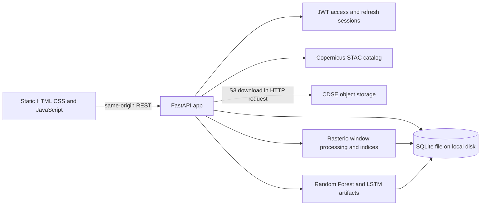

# Fasal Sanket architecture audit and migration risks

**Audit date:** 2026-11-17  
**Scope:** Existing frontend, FastAPI application, persistence, authentication, models, satellite pipeline, tests and deployment configuration. No application source was modified for this audit.

## Existing architecture

### Frontend

- Static HTML/CSS/JavaScript under `frontend/`; no JavaScript framework or build command (`frontend/package-lock.json` has no packages and there is no `package.json`).
- `frontend/app.js` owns hash routing, authenticated fetches, all workspace pages and workflow handlers.
- `frontend/index.html` and `frontend/app/index.html` are separate shells; the app route serves the latter through the static mount. Changes to persistent navigation must be applied to the served shell as well.
- Existing pages include Field Management, Live Crop Intelligence, Satellite Explorer, Crop Analytics, Resolution Calendar, Model Performance and the synthetic research experience.
- Production API selection was recently changed to use the page origin unless `window.FASAL_API_BASE_URL` is set. The FastAPI static mount currently serves both UI and API from one origin.

### API and authentication

- FastAPI routes and startup are in `backend/app/main.py`; local serving uses Uvicorn.
- Authentication uses scrypt password hashes, bearer access JWTs, and opaque refresh tokens stored as hashes. Refresh tokens are persisted in SQLite and returned in an HttpOnly cookie.
- Protected field, observation, acquisition and prediction lookups include `user_id` filters. Writes validate field ownership before persistence. New jobs must enforce this same field/user relationship on every read, cancel and result path.
- CORS is configured from `CORS_ORIGINS`; the checked-in example contains only local origins. Same-origin Vercel routing needs no broad wildcard CORS policy.

### Database and live data

- `backend/app/database.py` is a hand-written SQLite persistence layer using `sqlite3`, positional `?` placeholders, `PRAGMA`, `executescript`, JSON-in-TEXT columns, and startup-time schema changes. The SQLite file is `backend/data/fasal_sanket.sqlite3` by default.
- Foreign keys are enabled per SQLite connection. Fields own GeoJSON `boundary_json`; observation statistics and prediction reports are serialized JSON.
- Observation rows are idempotent by `(field_id, observed_at, source)`. Acquisitions are idempotent by `(user_id, field_id, scene_id)`. Predictions have no job-level idempotency key yet.
- The existing SQLite database was inspected read-only. Aggregate counts (no account details read): **3 users, 3 fields, 0 observations, 0 predictions, 1,114 satellite-acquisition records, 12 refresh-session records**. The ~1 MB DB includes meaningful ownership, field boundaries, session state and a large acquisition history. Do not replace or auto-migrate it destructively.
- Schema is currently initialized from application startup and `connection()`; no Alembic history exists. Startup also recomputes all field areas.

### Satellite pipeline

1. `GET /fields/{field_id}/satellite/scenes` calls the public CDSE STAC search with the saved GeoJSON and stores discovered acquisition metadata.
2. `GET /fields/{field_id}/satellite/acquisitions` returns acquisition stage counts and reports whether S3 credentials exist.
3. `POST /fields/{field_id}/observations/process` repeats scene discovery, filters cloud and assets, then downloads and processes up to 100 scenes **inside the HTTP request**. The path is: CDSE S3 assets → temporary directory → Rasterio JP2 windows → polygon mask/SCL cloud mask/nodata mask → reflectance conversion → NDVI/NDWI/EVI statistics → SQLite upsert.
4. Scene/acquisition states exist, but no independent job entity, queue, retry contract, heartbeat/lease, progress polling, cancellation or restart-recovery process exists.
5. `backend/app/sentinel_assets.py` needs `boto3` and Rasterio/GDAL with JP2 support at runtime. The audited `.venv312` lacks `boto3` and `rasterio`; no actual asset retrieval was available to test here. No CDSE S3 keys are configured in the process environment.

### Models and temporal behavior

- Random Forest (`rf_classifier.joblib`, ~6.4 MB) and LSTM (`lstm_classifier.pt`, ~0.23 MB) plus scaler/metadata are under `backend/models/`; synthetic training data is under `backend/data/`.
- `InferenceEngine` loads model artifacts synchronously in the FastAPI lifespan. Local direct load previously reported pipeline, Random Forest and LSTM available.
- `POST /fields/{field_id}/identify` currently runs temporal candidate generation synchronously from already stored real observations and saves a prediction. It does not acquire imagery.
- Its five checkpoint cutoffs select only observations on or before each checkpoint, so the existing temporal rule avoids future observations. Sparse bins are imputed and outputs remain experimental; synthetic model confidence is not empirical reliability.
- The public synthetic prediction and Resolution Calendar endpoints/pages must remain separate and compatible.

### Tests and environment

- Existing suite has 32 tests across API/auth, model/data, taxonomy, STAC processing and index/mask helpers.
- Last focused local run: 10 tests passed (`test_data`, `test_satellite_processing`, `test_sentinel_assets`, `test_taxonomy`). The full suite collects but currently stalls entering FastAPI `TestClient` lifespan before its first test; API/auth integration is not verified until this is diagnosed.
- The local virtual environment contains FastAPI, Uvicorn, Pydantic, NumPy, Pandas, SciPy, scikit-learn, PyTorch, joblib, Matplotlib, requests, pytest, httpx and python-dotenv. It does not contain `rasterio`, `boto3`, `SQLAlchemy`, `Alembic`, `psycopg` or Redis/Celery packages.
- No Vercel CLI/project link, Git metadata/remote, `DATABASE_URL`, `REDIS_URL`, CDSE S3 keys or worker deployment credentials were found. These are not read from the private `.env` or printed.

## Migration risks

1. **Data preservation:** the SQLite database holds three user identities, field boundaries and 1,114 acquisition records. A PostgreSQL migration must copy stable IDs, owner IDs, GeoJSON/JSON, timestamps and uniqueness semantics, validate foreign keys and counts, and emit per-record failures. Production target must be explicitly selected and never truncated or overwritten.
2. **Schema/driver changes:** `sqlite3.Row`, `?` parameters, SQLite `COLLATE NOCASE`, implicit TEXT-to-JSON conversions, `PRAGMA`, migrations and SQLite error classes are embedded throughout persistence and API error handling. These cannot be solved by only changing the connection URL.
3. **Job reliability:** committing a queued job and publishing to Redis are two systems. A durable outbox/redispatch mechanism is needed so a crash between those steps cannot strand work. Worker retries need idempotent observations and prediction-per-job writes.
4. **Long-running and large inputs:** processing 100 scenes can exceed serverless request time and scratch storage. Raster processing belongs in a separate worker with bounded concurrency, disk/memory limits, timeouts and durable progress.
5. **External dependencies:** actual S3 access, JP2/GDAL support, Redis, PostgreSQL and production credentials are absent locally. Tests can mock these interfaces, but real-Copernicus end-to-end verification requires configured services and accessible imagery.
6. **Compatibility:** the existing observation-processing endpoint returns finished observations synchronously. Moving it to queued processing changes its response semantics. Keep route paths where possible, return `202` with an explicit job payload, and update the existing frontend to poll; retain direct model-only identification for clients with already processed observations.
7. **Data sensitivity:** refresh sessions should be copied for continuity, but importing them must not weaken token expiry or cookie policy. Password hashes remain unchanged; no password reset or session token values should be exposed in migration reports.

## Proposed phased implementation

1. This audit and an explicit backend/worker architecture decision.
2. SQLAlchemy Core persistence that keeps SQLite as the local/test adapter and adds PostgreSQL via `DATABASE_URL`, plus Alembic migrations and a repeatable SQLite importer.
3. PostgreSQL job and outbox records; Celery + Redis dispatch with DB-backed stage/progress, retries, duplicate protection, leases/recovery, timeout and cancellation.
4. Extract current scene-processing and inference operations into worker-callable services without changing reflectance/index or temporal evidence rules; keep existing API route paths and update them to create jobs.
5. Polling/status UI using existing style and pages; do not redesign product navigation.
6. Tests for DB, ownership, job recovery/idempotency, science helpers, mocks and API/UI integration. Clearly label anything not exercised with real PostgreSQL/Redis/CDSE assets.
7. Deployment instructions for Vercel APIs/static app, managed Postgres, Redis and one independently deployed worker. No deployment occurs under this task.
